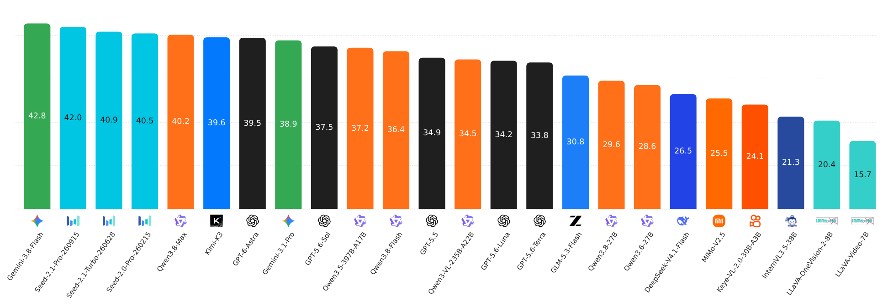
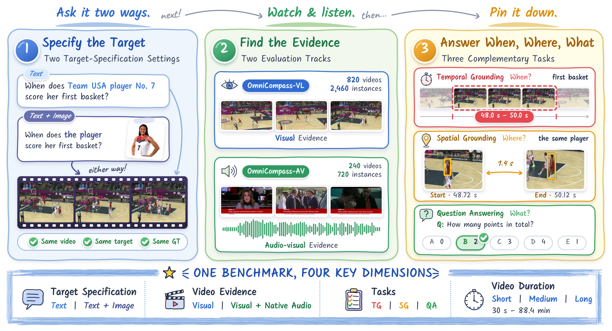
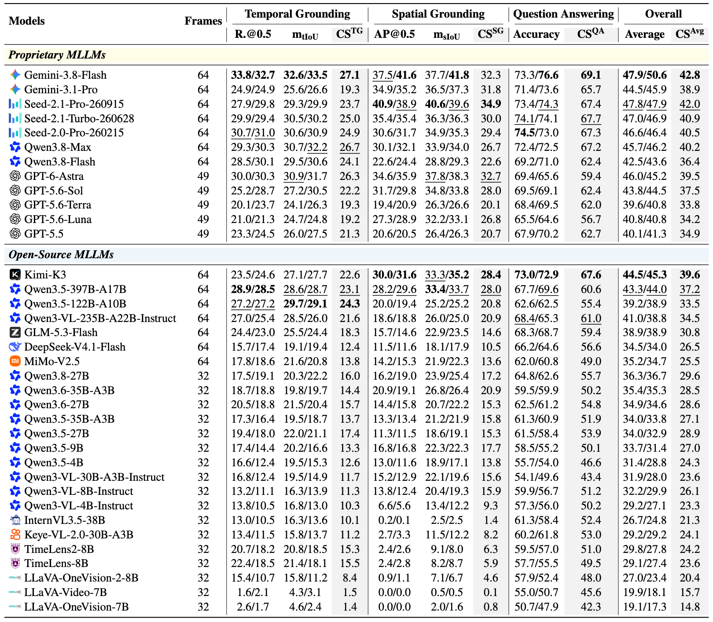
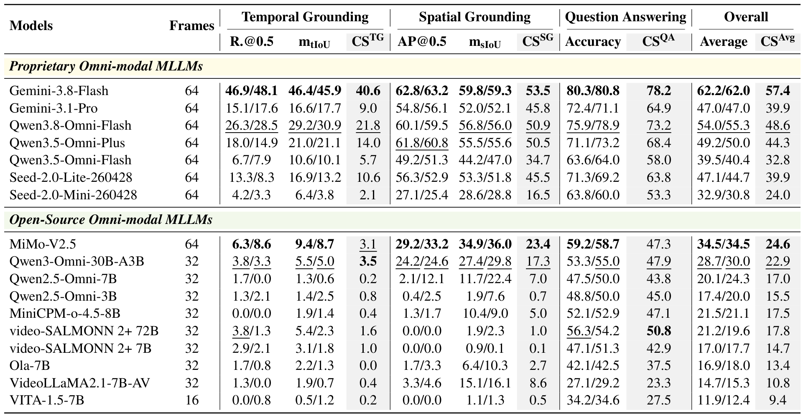

<div align="center">
<h1>OmniCompass: A Holistic Benchmark for Omni-Modal Video Grounding and Understanding</h1>

<p align="center">
  <strong>English</strong> | <a href="README_zh-CN.md">中文</a>
</p>

<p align="center">
Xuyang Liu<sup>1,2</sup>,
Shihao Wang<sup>1</sup>,
Xinyu Wei<sup>1,2</sup>,
Minghan Li<sup>3</sup>,
Zeqing Wang<sup>1,2</sup>,
<br>
Zuhao Yang<sup>4</sup>,
Zichen Wen<sup>5</sup>,
Lei Zhang<sup>1,2</sup>
<br><br>
<sup>1</sup> The Hong Kong Polytechnic University,
<sup>2</sup> OPPO Research Institute
<sup>3</sup> Colorado School of Mines,
<br>
<sup>4</sup> Nanyang Technological University
<sup>5</sup> Shanghai Jiao Tong University
</p>

<p align="center">
  
  <a href="https://github.com/PolyU-VCLab/OmniCompass"></a>
  <a href="https://huggingface.co/datasets/VCLab-PolyU/OmniCompass"></a>
  <a href="https://omnicompass.netlify.app/"></a>
</p>

</div>

<p align="center">
  
</p>

OmniCompass is a holistic benchmark for omni-modal video grounding and understanding, comprising **820 videos** and built with **approximately 1,800 human annotation hours**. It covers **2 target specifications (Text and Text+Image), 2 complementary evaluation tracks (OmniCompass-VL and OmniCompass-AV), 3 core tasks (temporal grounding, spatial grounding, and video question answering), and 3 video duration categories (short, medium, and long)**. We evaluate **50 MLLMs** on both task performance and cross-specification consistency.

## 📝 Content

- [News](#-news)
- [Overview](#-overview)
- [Evaluation Pipeline](#-evaluation-pipeline)
- [Experiments Results](#-experiments-results)
- [Citation](#-citation)
- [Contact](#-contact)

## 🔥 News

* **`2026.10.06`** 🤗🤗 We release OmniCompass, a holistic benchmark for omni-modal video grounding and understanding.

## ✨ Overview

<p align="center">
  
</p>

> **TLDR:** OmniCompass spans four dimensions: target specification, video evidence,
> task coverage, and video duration. Paired Text/Text+Image specifications are
> evaluated on the same targets. OmniCompass-VL contains 820 videos and 2,460
> instances, while the 240-video OmniCompass-AV subset contains 720 instances
> with native audio. Both tracks cover temporal grounding, spatial grounding,
> and question answering.

OmniCompass-VL evaluates general VLMs, while OmniCompass-AV evaluates
OmniLLMs with native audio-video understanding capabilities.

## 📐 Evaluation Pipeline

As for Coding Agent users, we recommend first installing the bundled
[omnicompass-eval skill](skills/omnicompass-eval/SKILL.md)
for evaluation with tools such as Codex or Claude Code.
Without installation, ask your agent to read
`skills/omnicompass-eval/SKILL.md` in this checkout and follow it.

**Self-hosted VLM example:**

> Use the omnicompass-eval skill to evaluate Qwen3.5-9B on OmniCompass-VL
> for TG, SG, and QA, using 32 frames and both Text and Text+Image settings.
> Run the model locally. First check the environment and data, list the
> configuration and request count, and wait for my confirmation before starting.

**API model example:** replace the placeholders with your provider's values.

> Use the omnicompass-eval skill to evaluate `<MODEL_ID>` through the API at
> `<API_BASE>` on OmniCompass-AV for TG, SG, and QA, using 64 frames and both
> Text and Text+Image settings. Read the key from `OMNICOMPASS_API_KEY`.
> First check the data and API's image/audio support, list the configuration
> and request count, and wait for my confirmation before any paid requests.

Provide the data path when asked. You can change the model, track, tasks, and
sampling in either prompt.

### Formal Evaluation

The commands below use the same `run.sh` entrypoint for API models and
self-hosted VLMs.

#### 1. Install dependencies

Use Python 3.12+ on Linux or macOS, or WSL2 on Windows.
Run these commands from the toolkit root in Bash:

```bash
python3 -m venv .venv
source .venv/bin/activate
pip install -r requirements-api.txt
```

Install FFmpeg for audio-enabled runs: `brew install ffmpeg` on macOS or
`sudo apt-get install ffmpeg` on Ubuntu. Put `ffmpeg` on PATH, or set
`FFMPEG_BINARY` to its executable path.
Check that `ffmpeg -version` runs successfully before audio-enabled evaluation.

#### 2. Prepare the data

Download the metadata and media shards from
[Hugging Face](https://huggingface.co/datasets/VCLab-PolyU/OmniCompass)
into `/path/to/download`.
Extract into a new directory and verify the files:

```bash
python code/release_tools.py validate --data /path/to/download
python code/release_tools.py extract --data /path/to/download --out /path/to/OmniCompass
python code/release_tools.py verify --data /path/to/OmniCompass
export DATA_ROOT=/path/to/OmniCompass
```

The extracted directory contains `videos.jsonl`, `questions.jsonl`, supporting
metadata, and the `videos/` and `references/` folders. Original MP4 files retain
their existing audio tracks; there is no separate audio download.
For a subset, pass the same repeated `--video-id` flags to extraction,
verification, and evaluation; the annotation files still describe the full dataset.

#### 3. API models

Configure a Chat Completions-compatible endpoint and its model ID:

```bash
export API_BASE=https://your-provider.example/v1
export MODEL_ID=your-model-id
export MODEL_NAME=Your-Full-Model-Name
read -r -s -p "API key: " OMNICOMPASS_API_KEY; echo
export OMNICOMPASS_API_KEY
```

Run all three tasks on OmniCompass-VL:

```bash
bash run.sh \
  --data "$DATA_ROOT" --api-base "$API_BASE" \
  --model "$MODEL_ID" --display-model "$MODEL_NAME" \
  --track VL --tasks TG,SG,QA --setting both \
  --nframe 64 --cache-dir .cache/frames \
  --output outputs/my-model-vl --concurrency 4 --resume
```

For OmniCompass-AV, change `--track VL` to `--track AV` and use a different
output directory. The endpoint must support multiple images and, when audio is
enabled, `input_audio`. By default, VL uses vision only and AV includes audio.

**Frame sampling**

Set the sampling options directly in the `bash run.sh` command.
The runner extracts frames automatically before inference; no separate
preprocessing step is required.

- `--nframe 64`: sample 64 frames at evenly spaced times across the full video.
  Change `64` to the desired count, such as `8`, `16`, `32`, or `128`.
- `--fps 1`: sample once per second, starting at zero. Replace `--nframe`
  with this option; the two cannot be used together.
- `--cache-dir .cache/frames`: save sampled images and timestamps here.
  Matching runs reuse the cached frames.

Each frame is paired with its actual timestamp. The reference image in
Text+Image is additional and does not count toward `--nframe`.
The sampler does not reduce the requested count to a model-specific limit.

**Audio**

For audio-enabled runs, the runner extracts the complete audio from each MP4
and caches it as mono 16 kHz, 32 kbps MP3. Original videos are never modified.
The cache retains the video's timeline, including any delayed audio start.
Use `--audio-cache-dir .cache/audio` to choose the cache location.

`--audio auto` preserves the paper settings: off for VL, on for AV.
Use `--audio on` or `--audio off` for an explicit modality experiment; the prompt
changes with the input and results record the choice. Audio-enabled selections
must contain audio in every video. Missing tracks cause an error, not silent
skipping or replacement with synthetic audio. Use a separate output directory
for each modality configuration.

| Option | Usage |
| --- | --- |
| `--setting text` / `text_image` / `both` | Run either setting or both; CS requires both |
| `--tasks TG,SG,QA` | Choose one or more tasks, separated by commas |
| `--nframe 64` / `--fps 1` | Choose a frame count or sampling frequency; frames are cached |
| `--video-id oc_516` | Test one video before a full run |
| `--max-requests 0` | Prepare selected media without model calls; exit code 2 and INCOMPLETE are expected |
| `--audio auto` / `on` / `off` | Use track defaults or explicitly enable/disable audio |
| `--concurrency 4` | Set concurrent API requests |
| `--max-completion-tokens 32768` | Set the output/reasoning token cap; default 32768 |
| `--thinking auto` / `on` / `off` | Enable or disable Thinking through the endpoint's supported toggle |
| `--thinking-api chat_template` / `enable_thinking` | Select the vLLM chat-template or DashScope request parameter |
| `--timeout 1200` | Set the response read timeout in seconds; default 1200 |
| `--resume` | Continue an interrupted run with the same configuration |

Both reference settings retain the selected video/audio inputs;
Text+Image additionally receives the reference image.
For vLLM Qwen endpoints, add `--thinking-api chat_template`; for DashScope,
use `--thinking-api enable_thinking`. Both enable Thinking by default.
Add `--thinking off` to disable it. Without an API toggle selection, `auto`
keeps the provider default. Explicit `on` or `off` requires a selected toggle;
an unsupported provider parameter must be resolved before evaluation.
Both modes keep the same 32768-token output budget, shared by reasoning and
the final answer. The server's total context must also fit the encoded input.
See `bash run.sh --help` for more options.

Completed responses that contain no parseable answer score zero and remain in
the task and CS denominators, including responses that exhaust the output budget.
The runner records them as processed and does not retry them on resume.
Parseable answers retain their existing scores even when the response is truncated.
Transport failures and content-policy refusals follow the existing exclusion rules.
The 32768-token default applies to new runs. Paper experiments used different
budgets, including 8192, 32768, and 8192 with targeted 32768-token recovery.
To reproduce a reported result, match that experiment's model, inputs, sampling,
generation budget, and retry policy. Keep runs with different configurations separate.

Scores are saved in `scores.json` and `scores.csv`; model responses are in
`predictions.jsonl`.
Only the final answer is scored. Original response content and separate reasoning
are retained in `response_meta`. Changing Thinking or generation settings requires
a new output directory.

#### 4. Self-hosted VLMs

Serve the model through a compatible endpoint, then use the same evaluation command.
For example, install a Qwen3.5-compatible vLLM version following the
[official deployment guide](https://huggingface.co/Qwen/Qwen3.5-9B#vllm)
in a separate GPU environment and start a local VL server:

The server image limit must allow the sampled frames plus one reference:
33 images for 32 frames, 65 for 64 frames, or 129 for 128 frames.
The context window must fit both the input and the output budget. The example
below uses 65536 tokens; check the model's capacity and available GPU memory.

```bash
vllm serve Qwen/Qwen3.5-9B \
  --host 127.0.0.1 --port 8000 --api-key local-eval \
  --limit-mm-per-prompt '{"image": 33}' \
  --reasoning-parser qwen3 \
  --max-model-len 65536 --max-num-seqs 1
```

In a separate terminal, activate the client environment and run the evaluation:

```bash
source .venv/bin/activate
export DATA_ROOT=/path/to/OmniCompass
export OMNICOMPASS_API_KEY=local-eval
bash run.sh \
  --data "$DATA_ROOT" --api-base http://127.0.0.1:8000/v1 \
  --model Qwen/Qwen3.5-9B --display-model Qwen3.5-9B \
  --track VL --tasks TG,SG,QA --setting both \
  --nframe 32 --cache-dir .cache/frames \
  --output outputs/qwen35-9b-vl --concurrency 1 --resume
```

## 📊 Experiments Results

**Evaluation results of different MLLMs on OmniCompass-VL.**

<p align="center">
  
</p>

**Evaluation results of different MLLMs on OmniCompass-AV.**

<p align="center">
  
</p>

## 📌 Citation

Please consider citing our works in your paper, if our findings help your research.

## 📩 Contact
For any question about our paper or code, please email `xu-yang.liu@connect.polyu.hk`.
